##### Задание 1. Сборка и публикация образа

1	Dockerfile:	многоступенчатая сборка, процесс в контейнере работает не от root (как Dockerfile.nonroot из ДЗ 3), .dockerignore

- в Dockerfile делаем 2-х этапную сборку: 1. приложение и библио, 2. переносим в отдельный образ
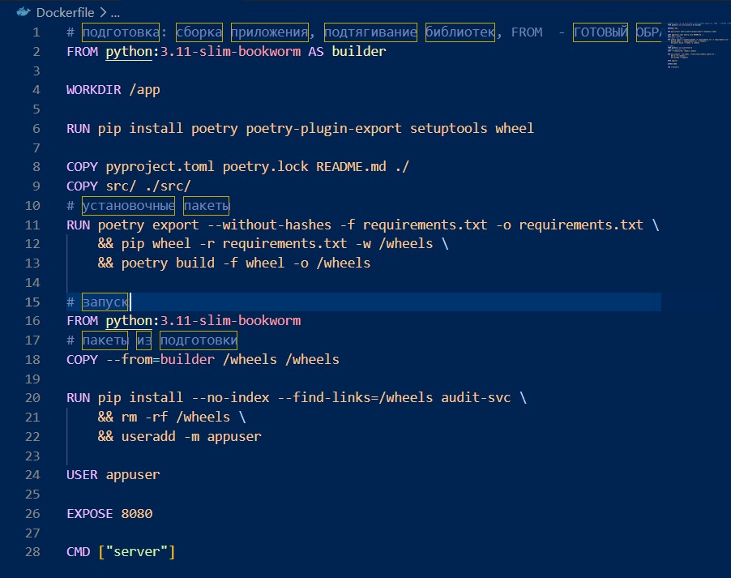

- добавляем .dockerignore (чтобы не подтягивал лишнее):
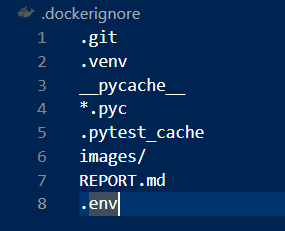

- запустим саму сборку образа ```docker build -t audit-svc:test .```
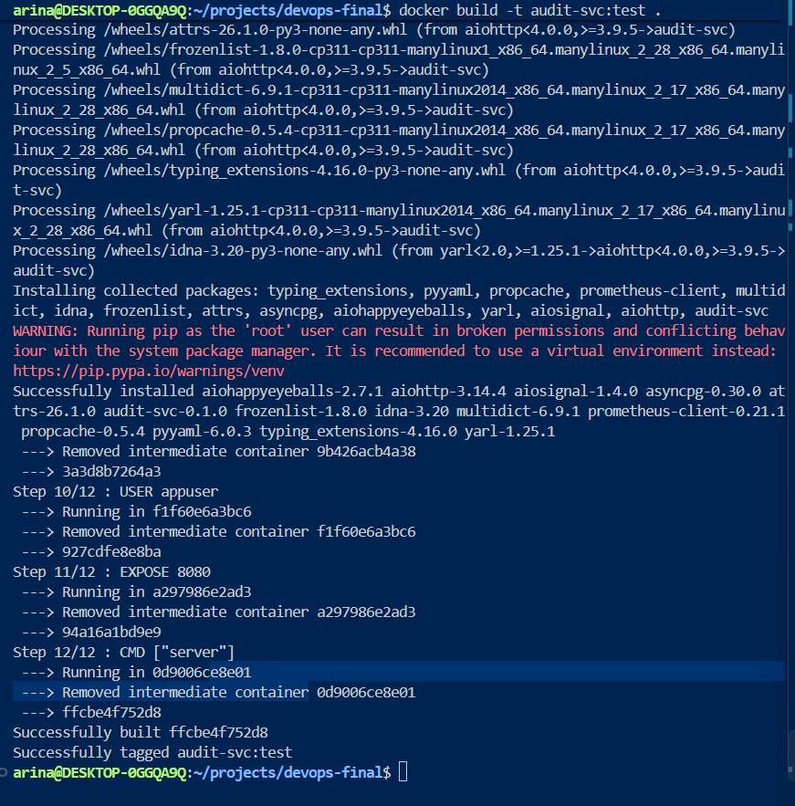

- все супер, проверим запуск ```docker run --rm --entrypoint id audit-svc:test```:
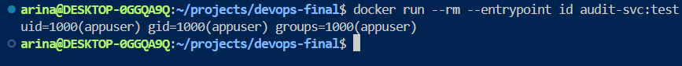

- ок! запускается от пользователя appuser

- проверка migrate, generate (для обновления бд, тест), внутри нашего образа все запускается
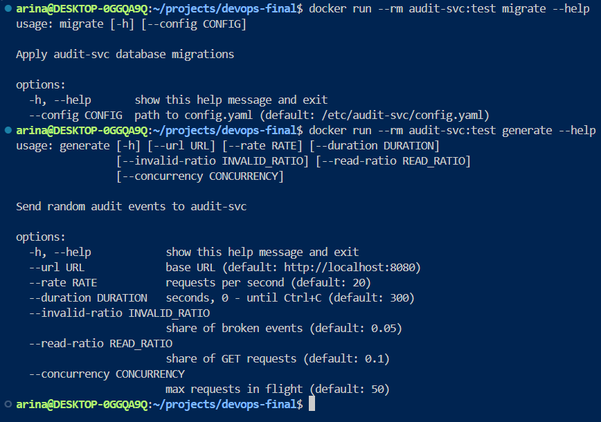

2	Пайплайн на ветке по умолчанию:	тесты (poetry run pytest, отчёт JUnit), сборка, публикация образа с тегом main_<короткий sha>	
- настроили проверку и публикацию через github actions
- любуемся результатом пайплайна:
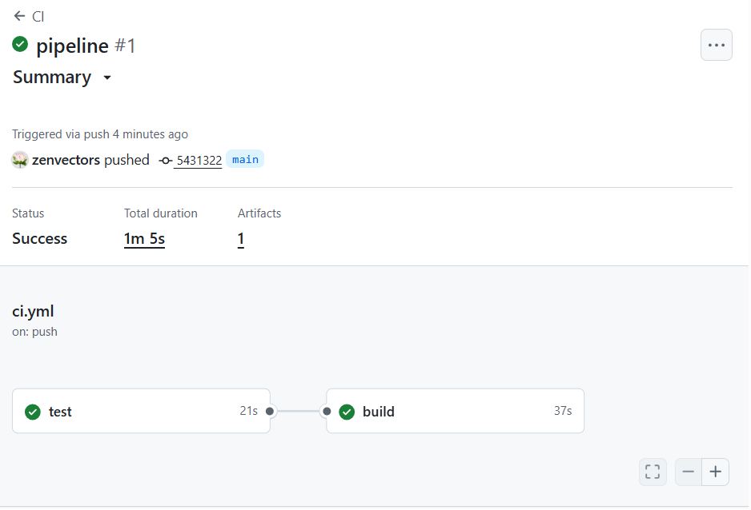

- образ опубликован
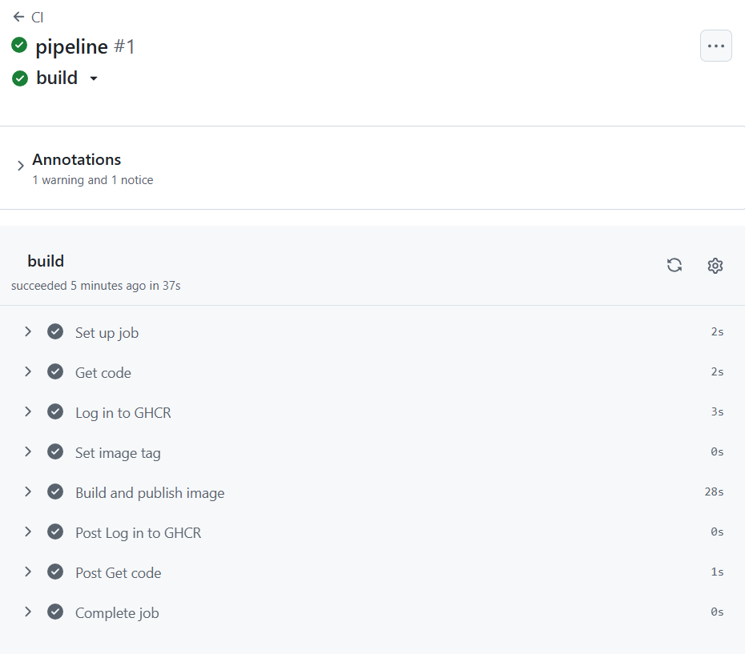
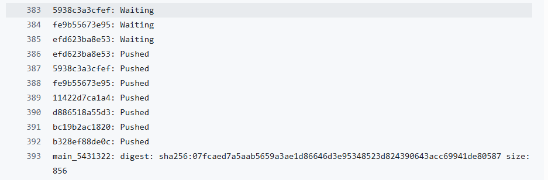

3	Пайплайн на защищённом теге: на теге vX.Y.Z публикуется образ с тегом vX.Y.Z, затем запускается развёртывание 

- добавили запуск по релизным тегам
- 


##### Задание 2. База данных и секреты

1	PostgreSQL:	контейнер postgres:17 на целевой машине, данные в именованном томе; порт наружу не публикуется (допустимо только 127.0.0.1 целевой машины)

- запустили PostgreSQL 17 через Ansible. (данные хранятся в отдельном audit_pg_data, контейнер подключён к сети audit_net)
- запускаем:
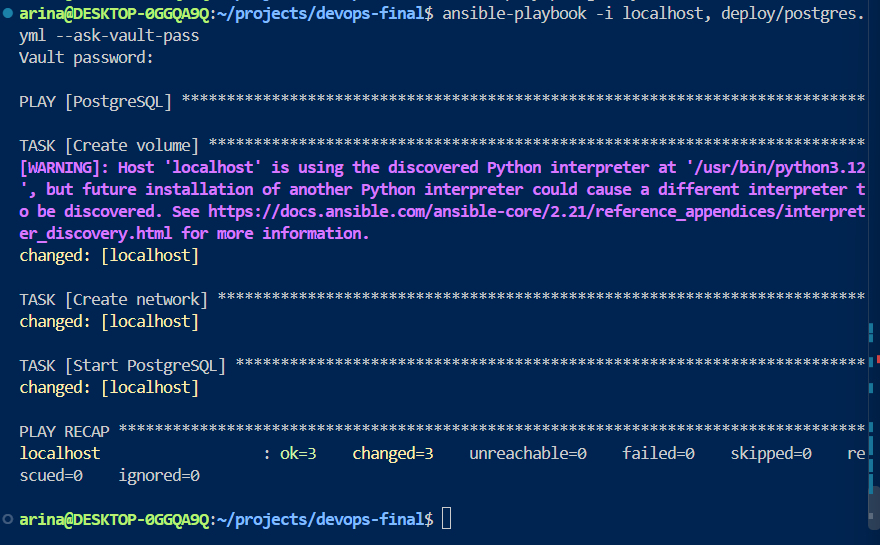

- проверка: контейнер запущен, порт наружу не опубликован
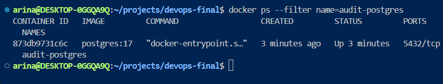

2	БД и пользователь: создаются Ansible-задачами: БД audit, пользователь audit_svc — владелец этой БД. Используйте модули community.postgresql или задачи п. 8–9 из своей роли ДЗ 2

- обновили базу audit и пользователя audit_svc, все супер Ansible отрабатывает, 
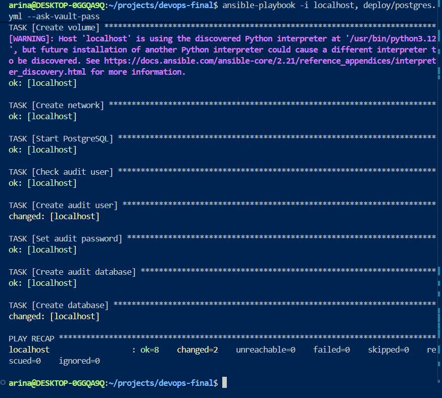

- проверяем владельца бд
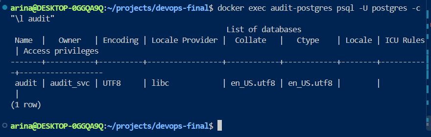

- поменили psql на модули community.postgresql, повторный запуск без изменений:
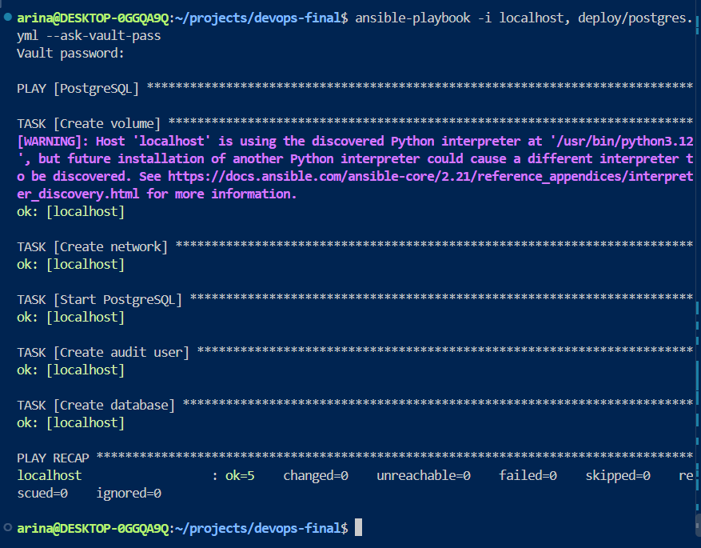

3	Секреты: пароль суперпользователя и пароль audit_svc лежат в group_vars/.../vault.yml, зашифрованном ansible-vault. В открытом виде их нет ни в репозитории, ни в логах CI


- пароли PostgreSQL хранятся в vault.yml, зашифрованном с помощью Ansible Vault:
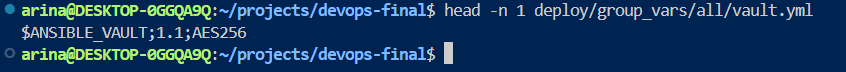


4	Ключ ansible-vault в CI:  хранится в CI-переменной (Masked + Protected) или секрете окружения GitHub. Ansible получает его через --vault-password-file

- оздали окружение deploy на GitHub и добавили секрет ANSIBLE_VAULT_PASSWORD, в пайплайне предусмотрели передачу пароля Ansible через --vault-password-file
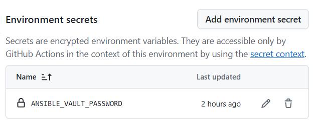

- 

##### Задание 3. Развёртывание из CI

1	Задача развёртывания: запускается только на защищённом теге после публикации образа; выполняется на целевой машине (tags: [deploy]), разворачивает образ с тегом этого релиза. В варианте 1 — environment с URL сервиса

- настроили self-hosted runner wsl-deploy с меткой deploy, он подключается к GitHub и может запускать задачи на нашей WSL, добавили задачу deploy в GitHub Actions: она должна выполняться после публикации релизного образа:
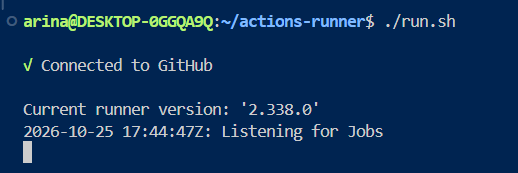

-

-

2	Конфиг из шаблона: config.yaml сервиса генерируется модулем template из зашифрованных переменных. Права файла не шире 0640, но процесс в контейнере должен его читать

- создали config.yaml.j2, Ansible подставляет в него пароль из Vault и сохраняет готовый config.yaml с правами 640

- Проверили, что audit-svc читает конфиг, подклбчается к PostgreSQL, статус ок - приложение успешно подключилось
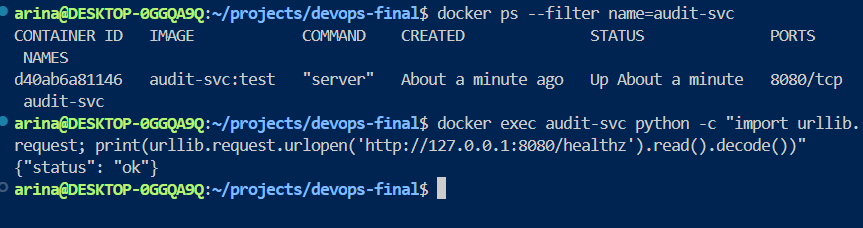

- проверяем права доступа к config.yaml - 640 (владелец может читать и изменять файл, группа только читать, остальные пользователи не имеют доступа)

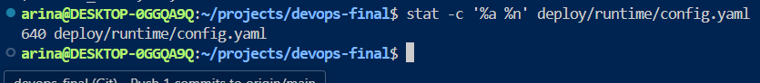


3	Перечитывание вместо перезапуска: при изменении конфига хендлер вызывает POST /reload, а контейнер сервиса не перезапускается. Это аналог опции command у Vault Agent	

- изменили пароль пользователя audit_svc, повторно запустили Ansible, пароль в базе и конфиг обновились, /reload

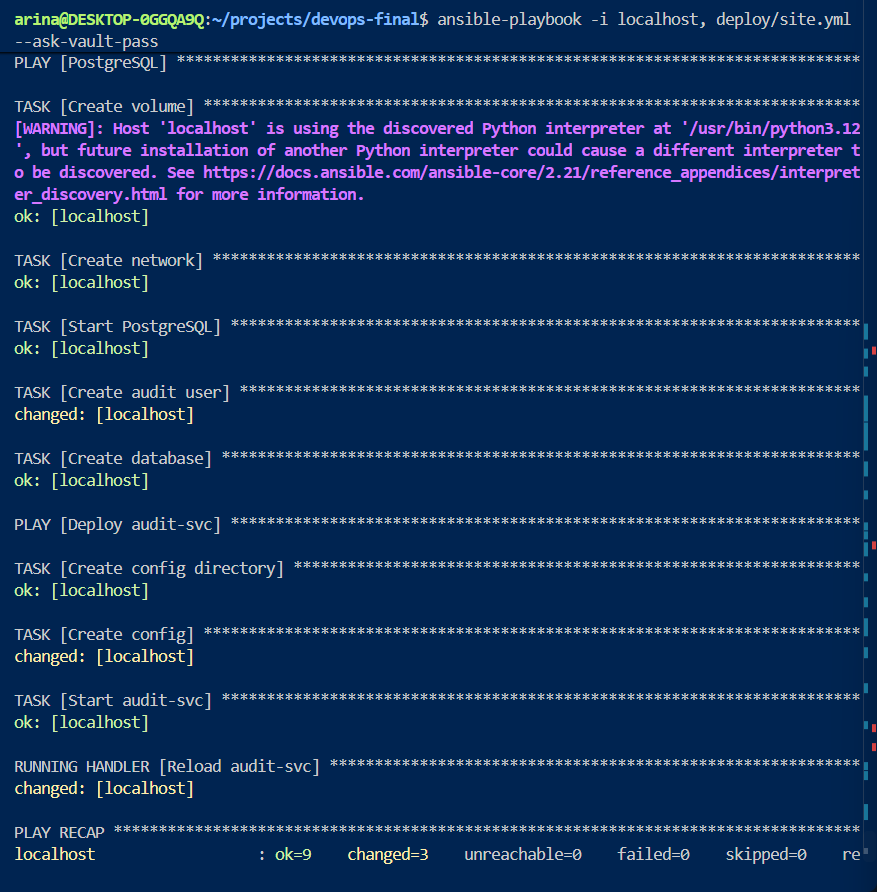

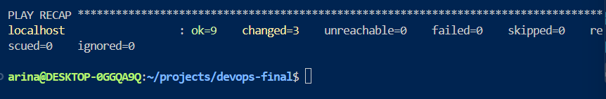

- время запуска контейнера до и после смены пароля не изменилось (обновили подключение без перезапуска сервис), база доступна

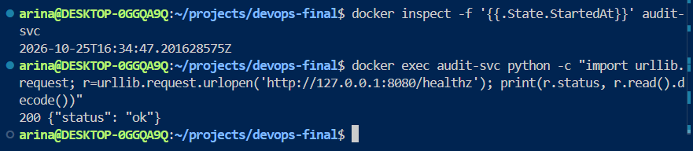

4	Идемпотентность: повторный запуск задачи без изменений: changed=0, хендлер не срабатывает


- объединили настройку PostgreSQL и приложения в site.yml:
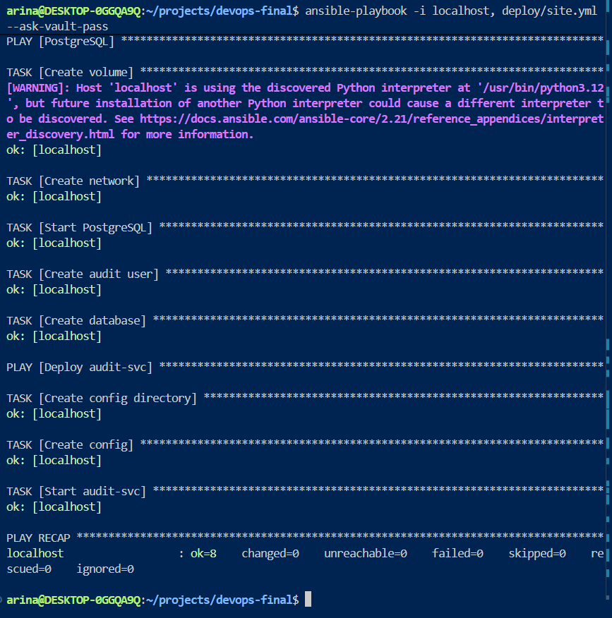

##### Задание 4. Nginx и nginx-exporter

1	Доступ только через Nginx: из всех контейнеров развёртывания порт наружу публикует только Nginx (и exporter, см. п. 3). Сервис и PostgreSQL в отдельной docker-сети без ports

2	/reload закрыт: запрос к /reload через Nginx возвращает 404 и не доходит до сервиса

3	nginx-exporter: контейнер nginx/nginx-prometheus-exporter:1.4 читает stub_status Nginx (инструкция); stub_status недоступен на основном порту; на :9113/metrics есть nginx_up 1


##### Задание 5. Мониторинг (2 балла)

1	Сбор метрик: задания audit-svc и nginx в prometheus.yml, обе цели UP на /targets

2	Нагрузка: generate запущен минимум на 10 минут (например, docker run --rm ... generate --url http://nginx:8080 --duration 600 в сети развёртывания)

3	Дашборд сервиса: созданный вами, три панели (таблица ниже), JSON выгружен в репозиторий

4	Дашборд Nginx: дашборд из репозитория nginx-exporter импортирован, на нём есть данные


